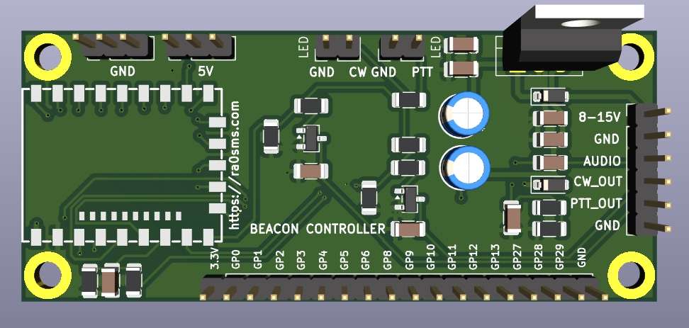
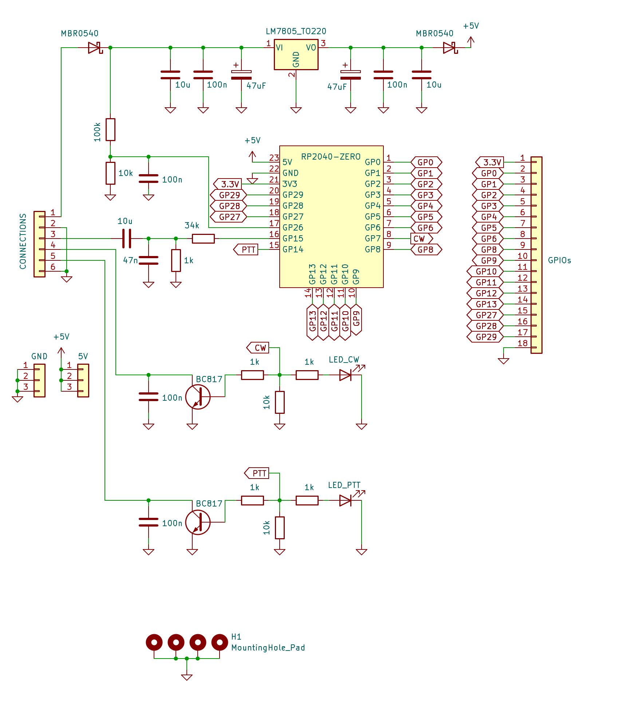
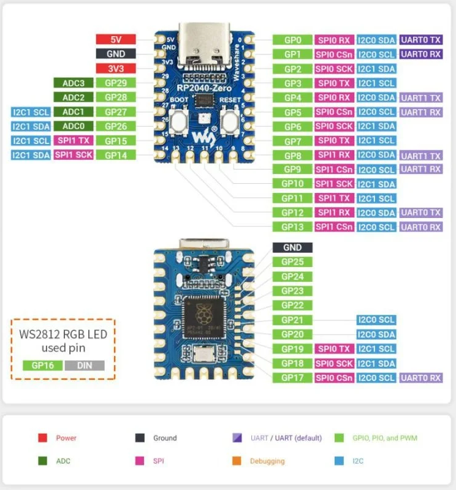
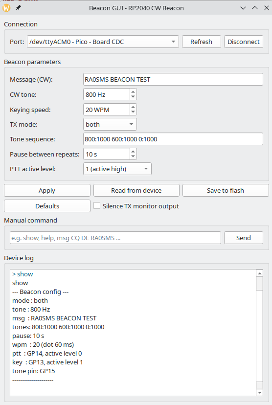

# Beacon — CW (Morse) Beacon for HF or VHF Radio

A Morse-code beacon controller built around the [Waveshare RP2040-Zero](https://www.waveshare.com/wiki/RP2040-Zero) module (Raspberry Pi RP2040), designed for keying an HF/VHF FM/SSB/CW transmitter.

The project consists of:

- **Firmware** — generates a sine audio tone, controls the transmitter PTT and CW key, transmits a configurable message stored in flash and repeats it with a configurable pause. All parameters are configurable at runtime over a USB serial console and persist across power cycles.
- **Controller board** (KiCad) — power supply 8–15 V, audio output with attenuator and low-pass filter, open-collector PTT and CW key outputs, supply voltage divider and expansion headers. Gerber files are ready for ordering.
- **Desktop GUI** — configuration and monitoring tool for Linux and Windows.



## Repository layout

| Path | Contents |
|------|----------|
| [`code/Beacon/`](code/Beacon/) | Firmware source (Pico SDK, CMake) |
| [`firmware/`](firmware/) | Prebuilt firmware `.uf2` |
| [`gui/`](gui/) | Configuration GUI (`beacon_gui.py`, Windows build in `beacon_gui.zip`) |
| [`KiCad/beacon_rp2040/`](KiCad/beacon_rp2040/) | Board schematic and PCB (KiCad 10), schematic PDF, Gerber files, interactive BOM |
| [`scripts/`](scripts/) | Build / flash helper scripts |
| [`pics/`](pics/) | Schematic, 3D view, screenshots |

## Features

- **Telegraph tone output** — clean sine wave (DDS over a 62.5 kHz PWM carrier) with 5 ms raised-cosine rise/fall to avoid key clicks, 100–5000 Hz (600/800 Hz typical for FM audio), default **800 Hz**
- **PTT control** — asserted at the start of the transmission and released after the end of the message, with lead/tail delays
- **Morse message** — full A–Z, 0–9, `. , ? / - = @ : + ( ) " ' !` and prosigns (`<SK>`, `<BT>`, `<AR>`, …) encoding with standard element timing; speed set directly in WPM (default **20 WPM**)
- **Tone sequences** — an arbitrary chain of tone bursts ("freq:ms" pairs, `0` = silence), transmittable instead of (or after) the Morse message
- **Transmission modes** — `cw` (Morse only), `tones` (tone sequence only), or `both` (Morse, then tones) within one PTT
- **Non-volatile configuration** — stored in the last sector of the onboard flash; survives power-off and reflashing
- **Ready-to-flash firmware** — a prebuilt `.uf2` binary is included in [`firmware/`](firmware/), no toolchain required
- **USB console** — live configuration over the USB CDC serial port
- **Transmitter safety** — time-out timer (PTT is forcibly released after 120 s), hardware watchdog (reboot with PTT off if the firmware hangs), `txen 0` aborts the transmission immediately
- **Accurate keying** — the whole transmission is laid out in advance and played by a hardware timer, so console activity and USB output do not affect the timing
- **Status LED** — onboard WS2812 (GP16): steady green in the pause, red blinking in sync with the keying during transmission; brightness configurable

## Hardware

### Controller board



Two-layer board, 75 × 32 mm, four M3 mounting holes (connected to GND). The RP2040-Zero module is soldered flat onto the board by its castellated pads; its USB-C connector faces the board edge and is used for configuration and firmware updates. Full schematic: [`beacon_rp2040.pdf`](KiCad/beacon_rp2040/beacon_rp2040.pdf).

#### Main connector J1 (to the transmitter)

| Pin | Label | Function |
|-----|-------|----------|
| 1 | `8-15V` | Supply input, 8–15 V DC (reverse-polarity protected) |
| 2 | `GND` | Ground |
| 3 | `AUDIO` | Audio output → transmitter microphone / modulation input |
| 4 | `CW_OUT` | CW key output, open collector to GND (closed while the tone sounds) |
| 5 | `PTT_OUT` | PTT output, open collector to GND (closed during transmission) |
| 6 | `GND` | Ground |

#### Outputs

- **PTT / CW key** — BC817 NPN transistors, open collector to ground: connect directly to the radio's PTT and straight-key inputs (both are normally "close to ground" lines). Up to 45 V and ~50–100 mA. When switching a relay coil, put a flyback diode across the coil. Each output has a 100 nF capacitor to ground against RF pickup and a 10 kΩ pull-down on the base drive, so the outputs stay off while the module boots.
- **Audio** — GP15 sine → 34 kΩ / 1 kΩ divider → 47 nF low-pass (≈3.5 kHz, suppresses the 62.5 kHz PWM carrier) → 10 µF coupling capacitor. Output level is about 90 mV p-p (≈30 mV RMS) at the default settings — suitable for a microphone input. For a line/data input increase the 1 kΩ resistor (R2) or decrease the 34 kΩ resistor (R1).
- **Status LEDs** — headers `LED` / `CW`–`GND` and `LED` / `PTT`–`GND` for external indicator LEDs (anode to `CW`/`PTT`, cathode to `GND`; 1 kΩ series resistors are on the board). They light while the key is closed / PTT is active. The onboard WS2812 of the RP2040-Zero shows the beacon state as well.

#### Power supply

- Input 8–15 V → MBR0540 reverse-polarity diode → LM7805 (TO-220) → MBR0540 → +5 V rail → RP2040-Zero (its own 3.3 V regulator).
- The output diode isolates the regulator from USB: with only USB connected the board is powered from the computer (handy for configuration); with both connected the higher voltage wins, nothing is back-fed.
- The 7805 needs ~2 V of headroom plus ~0.3 V for the input diode, hence the 8 V minimum. At 13.8 V it dissipates about 8.5 V × load current — fine for the beacon itself (tens of mA) without a heatsink; keep external loads on the 5 V / 3.3 V headers small (≲100 mA) or add a heatsink.
- Supply voltage divider 100 kΩ / 10 kΩ + 100 nF to **GP26 (ADC0)**, ratio 1:11, range up to ~36 V — reserved for supply monitoring (not used by the firmware yet).

#### Expansion headers

| Header | Pins |
|--------|------|
| J2 `GPIOs` (18 pins) | 1 `3.3V`, 2–8 `GP0`–`GP6`, 9–14 `GP8`–`GP13`, 15–17 `GP27`–`GP29` (ADC1–ADC3), 18 `GND` |
| J3 `GND` | 3 × GND |
| J4 `5V` | 3 × +5 V rail (≈4.7 V after the isolation diode, or USB 5 V) |

GPIOs are 3.3 V logic and are not 5 V tolerant. GP7, GP14, GP15 and GP26 are used by the board and are not brought out.

#### RP2040-Zero pin usage

| Signal | GPIO | Description |
|--------|------|-------------|
| Tone   | GP15 | Audio tone (sine via PWM) → J1 `AUDIO` |
| PTT    | GP14 | PTT transistor → J1 `PTT_OUT`, PTT LED |
| CW key | GP7  | CW key transistor → J1 `CW_OUT`, CW LED |
| Vin sense | GP26 | Supply voltage divider (ADC0) |
| WS2812 | GP16 | Onboard status LED (built into the module) |



#### Manufacturing files

| File | Contents |
|------|----------|
| [`KiCad/beacon_rp2040/beacon_rp2040_gerbers.zip`](KiCad/beacon_rp2040/beacon_rp2040_gerbers.zip) | Gerber + drill files, ready to upload to a PCB manufacturer (2 layers, 1.6 mm) |
| [`KiCad/beacon_rp2040/gerbers/`](KiCad/beacon_rp2040/gerbers/) | The same files, unpacked |
| [`KiCad/beacon_rp2040/bom/ibom.html`](KiCad/beacon_rp2040/bom/ibom.html) | Interactive BOM / placement helper (download and open in a browser) |
| [`KiCad/beacon_rp2040/beacon_rp2040.pdf`](KiCad/beacon_rp2040/beacon_rp2040.pdf) | Schematic (PDF) |

#### Bill of materials

| Qty | Value | Package | References |
|-----|-------|---------|------------|
| 1 | Waveshare RP2040-Zero | castellated module | U1 |
| 1 | LM7805 | TO-220 | U2 |
| 2 | BC817 (2N7002 also fits) | SOT-23 | Q3, Q4 |
| 2 | MBR0540 | SOD-123 | D1, D4 |
| 1 | 34 kΩ (33 kΩ is fine) | 1206 | R1 |
| 1 | 100 kΩ | 1206 | R7 |
| 3 | 10 kΩ | 1206 | R3, R5, R8 |
| 5 | 1 kΩ | 1206 | R2, R4, R6, R9, R10 |
| 5 | 100 nF | 1206 | C2, C3, C5, C10, C11 |
| 3 | 10 µF ceramic, ≥25 V | 1206 | C4, C9, C12 |
| 1 | 47 nF | 1206 | C6 |
| 2 | 47 µF electrolytic, ≥25 V | radial 5 mm | C13, C14 |
| 1 | Pin header 1×6, 2.54 mm | THT | J1 |
| 1 | Pin header 1×18, 2.54 mm | THT | J2 |
| 2 | Pin header 1×3, 2.54 mm | THT | J3, J4 |
| 2 | Pin header 1×2, 2.54 mm (external LEDs) | THT | D2, D3 |

## Flashing

A prebuilt firmware binary is included in the repository: [`firmware/Beacon-v0.2.uf2`](firmware/Beacon-v0.2.uf2). You do not need to build anything to flash it.

**Method 1 — BOOTSEL button:**

1. Hold the BOOT button and connect the board via USB.
2. The board appears as a USB mass-storage device (`RPI-RP2`).
3. Copy the firmware: `cp firmware/Beacon-v0.2.uf2 /run/media/$USER/RPI-RP2/`

**Method 2 — picotool (no button required):**

```bash
picotool load firmware/Beacon-v0.2.uf2 -fx
```

If the currently running firmware does not support USB reboot, use the BOOTSEL button method.

## Configuration commands (USB console)

Connect to the board's serial port (`/dev/ttyACM0` on Linux, e.g. `minicom -D /dev/ttyACM0` or `picocom /dev/ttyACM0`). Any baud rate works.

Type the command and press **Enter**. If your terminal can send no line ending, the line is executed automatically after a 5-second pause in typing.

| Command        | Description                                        |
|----------------|----------------------------------------------------|
| `msg <text>`   | Set message text (A–Z, 0–9, `. , ? / - = @ : + ( ) " ' !`); prosigns in angle brackets are sent without letter gaps, e.g. `<SK>`, `<BT>`. Max 95 characters |
| `tone <hz>`    | Set tone frequency, 100–5000 Hz                    |
| `pause <sec>`  | Pause between message repeats, 0–3600 s            |
| `wpm <5..60>`  | Keying speed, words per minute (dot = 1200 / wpm)  |
| `tones <f:d> ...` | Tone sequence: `freq:ms` pairs, freq 0–5000 Hz (`0` = silence), duration 10–10000 ms, up to 24 entries. Without arguments — show current sequence |
| `txmode cw\|tones\|both` | What to transmit: Morse only / tone sequence only / both |
| `txen <0\|1>`   | Enable/disable transmission (0 = stops immediately, PTT released; beacon stays silent, e.g. while tuning) |
| `led <0..100>` | Status LED brightness, % (default 20)              |
| `save`         | Write current configuration to flash (during a transmission it is deferred until the transmission ends) |
| `show`         | Print current configuration                        |
| `default`      | Restore factory defaults                           |
| `ver`          | Firmware version (program version and git revision) |
| `help`         | Show command list                                  |

Changes take effect immediately (from the next transmission); use `save` to make them permanent. Invalid values are rejected with an `error:`/`usage:` reply and leave the setting unchanged. When the message, speed, mode or tone sequence makes a transmission longer than the 120 s time-out, a `warning:` is printed — such a transmission would be cut off. `show` also prints the transmission length (`txlen`).

The configuration is stored with a version number and CRC-32; a configuration saved by firmware v0.1 is migrated automatically on first boot.

### Example session

```
msg CQ CQ CQ DE RA0SMS K
tone 600
pause 15
wpm 18
txmode both
tones 800:150 0:100 800:150 0:100 1200:150 0:500
save
```

## Helper scripts

| Script | Purpose |
|--------|---------|
| [`scripts/build.sh`](scripts/build.sh) | Configure (once) and build the firmware → `code/Beacon/build/Beacon.uf2` |
| [`scripts/flash.sh`](scripts/flash.sh) | Flash the built firmware to the board via picotool (auto-detects the picotool from the Pico VS Code extension; override with `PICOTOOL=/path/to/picotool`) |
| [`scripts/build_gui_exe.bat`](scripts/build_gui_exe.bat) | (Windows) Build the standalone `gui/beacon_gui.exe` with PyInstaller (pack it into `gui/beacon_gui.zip` for the repository) |
| [`scripts/update_firmware.sh`](scripts/update_firmware.sh) | Copy the freshly built binary to the tracked [`firmware/Beacon-v0.2.uf2`](firmware/Beacon-v0.2.uf2) |

Typical workflow: `./scripts/build.sh && ./scripts/flash.sh`, then `./scripts/update_firmware.sh` before committing a new firmware version.

## Building from source

If you want to modify the firmware, build it yourself. The project uses:

- **[Raspberry Pi Pico SDK](https://github.com/raspberrypi/pico-sdk)** 2.3.1 (developed with this version; other 2.x versions likely work)
- **CMake** ≥ 3.13
- **ARM GCC cross-toolchain** — `arm-none-eabi-gcc` (the SDK 2.x toolchain package `15_2_Rel1` or any recent version)
- **Ninja** or GNU Make (Ninja is recommended)

### Installing the toolchain

**Fedora / RHEL:**

```bash
sudo dnf install arm-none-eabi-gcc-cs arm-none-eabi-newlib cmake ninja-build
git clone -b 2.3.1 https://github.com/raspberrypi/pico-sdk.git ~/pico-sdk
export PICO_SDK_PATH=~/pico-sdk   # add to ~/.bashrc or ~/.zshrc
```

**Debian / Ubuntu:**

```bash
sudo apt install gcc-arm-none-eabi libnewlib-arm-none-eabi libstdc++-arm-none-eabi-newlib cmake ninja-build
git clone -b 2.3.1 https://github.com/raspberrypi/pico-sdk.git ~/pico-sdk
export PICO_SDK_PATH=~/pico-sdk   # add to ~/.bashrc
```

Alternatively, install the official **Raspberry Pi Pico VS Code extension** — it manages the SDK, toolchain, ninja and picotool automatically (in `~/.pico-sdk`); the project's VS Code configuration in [`code/Beacon/.vscode/`](code/Beacon/.vscode/) is prepared for it.

### Building

```bash
cmake -B code/Beacon/build -S code/Beacon
cmake --build code/Beacon/build
```

The firmware binary is produced at `code/Beacon/build/Beacon.uf2`.

`picotool` (for USB flashing without the BOOTSEL button) is bundled with the VS Code extension, or can be built from [picotool](https://github.com/raspberrypi/picotool) / installed as `picotool` package on recent distros. Without it, use the BOOTSEL button method.

### Flashing the built firmware

**Method 1 — BOOTSEL button:**

1. Hold the BOOT button and connect the board via USB.
2. The board appears as a USB mass-storage device (`RPI-RP2`).
3. Copy the firmware: `cp code/Beacon/build/Beacon.uf2 /run/media/$USER/RPI-RP2/`

**Method 2 — picotool (no button required):**

```bash
picotool load code/Beacon/build/Beacon.uf2 -fx
```

If the currently running firmware does not support USB reboot, use the BOOTSEL button method.

## GUI (configuration tool)

A PyQt5/PyQt6 desktop GUI is available for convenient configuration and monitoring: [`gui/beacon_gui.py`](gui/beacon_gui.py).

**Windows users:** a standalone build that needs no Python installation is available: [`gui/beacon_gui.zip`](gui/beacon_gui.zip) — download, unpack and run `beacon_gui.exe`. On first launch the SmartScreen may warn about an unsigned binary; choose "More info" → "Run anyway".

Install the Python dependencies:

```bash
pip install -r requirements.txt
```

This installs **pyserial** and **PyQt5**. If only **PyQt6** is available (or PyQt5 is not installed), the GUI automatically uses PyQt6 instead — pyserial is required in either case.

Run the GUI:

```bash
python3 gui/beacon_gui.py
```

Features:

- Serial port selection with auto-detection of the Pico CDC port, connect/disconnect
- Editing all parameters: message, CW tone, keying speed (WPM), tone sequence, TX mode, pause, LED brightness; the message field only accepts characters the firmware can send
- **Apply** sends the fields one by one, waiting for the device's reply to each; rejected values and time-out warnings are reported in a summary dialog
- **Save to flash** — Apply, then `save`; **Read from device** — fills the fields from the device; **Defaults**
- **Transmission enabled** checkbox — temporarily stop the beacon (e.g. while tuning) and resume it later
- Firmware version display; a lost connection (cable unplugged, board reset) is detected automatically
- Live device log, optional hiding of TX monitor output
- Manual command line for any console command

On connection the GUI automatically requests the current configuration from the device and fills in the fields.



## Pin configuration

Pins and fixed parameters are defined at the top of [`code/Beacon/Beacon.c`](code/Beacon/Beacon.c):

```c
#define TONE_PIN          15   // Telegraph tone output
#define PTT_PIN           14   // PTT output (active high)
#define KEY_PIN           7    // CW key output (active high)
#define PTT_LEAD_MS       1000 // PTT lead-in delay, ms
#define PTT_TAIL_MS       100  // PTT tail delay, ms
#define TX_MAX_MS         120000 // Time-out timer: max PTT time per transmission, ms
#define WATCHDOG_MS       3000 // Watchdog timeout, ms
```

The PTT and CW key GPIOs are always **active high** (logic 1 while transmitting / keyed) — this is fixed in the firmware, no configuration needed. On the controller board they drive the open-collector transistors, so J1 `PTT_OUT` / `CW_OUT` are closed to ground while active.

## License

MIT
